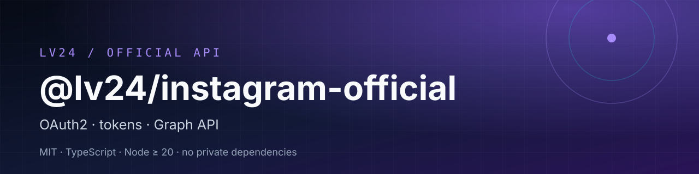

# @lv24/instagram-official

[](https://www.npmjs.com/package/@lv24/instagram-official)
[](https://www.npmjs.com/package/@lv24/instagram-official)
[](https://github.com/LevapVeeskela/lv24-instagram-official/actions/workflows/ci.yml)
[](https://github.com/LevapVeeskela/lv24-instagram-official/pkgs/npm/instagram-official)
[](LICENSE)
[](package.json)
[](package.json)

> **Official Instagram Graph API, typed end to end.** OAuth2 authorization,
> short- and long-lived token exchange, refresh and storage, plus a
> `GraphApiProcessor` for profile, media, publishing, insights, comments and
> hashtag search.

> **Кратко по-русски.** Официальный клиент Instagram Graph API: OAuth2,
> короткие и долгие токены, refresh, хранение токенов, публикация, инсайты,
> комментарии и поиск по хэштегам. MIT, TypeScript, Node.js ≥ 20. Нужен
> Business или Creator аккаунт и приложение Meta.

| 🚀 Start | 🧠 Use | 🛠 Build |
| --- | --- | --- |
| [Install](#install) · [OAuth2 quick start](#oauth2-quick-start) | [Token lifecycle](#token-lifecycle) · [Graph API](#graph-api) · [Scopes](#scopes) | [Errors](#errors-and-rate-limits) · [Security](#security) · [Contributing](#contributing) |

## Why @lv24/instagram-official

- **Official only.** No private endpoints, no session cookies, no reverse
  engineering. This package is safe to ship in a product.
- **Typed OAuth2.** Authorization URL, code exchange, long-lived exchange,
  refresh, revoke, debug — all with explicit config and injectable transport.
- **Testable transport.** `OAuth2Manager` takes an `IHttpClient`; use
  `UndiciHttpClient` in production and a mock in tests.
- **Token storage included.** `InMemoryTokenStorage` for tests,
  `FileTokenStorage` for a single-process app, or implement `TokenStorage`.
- **Graph calls return results.** `GraphApiProcessor` returns
  `IResult<T>` from `@lv24/kernel` instead of throwing on every error.
- **Small dependency graph.** Only `@lv24/kernel` at runtime.

## Install

```sh
npm install @lv24/instagram-official @lv24/kernel
```

Requires Node.js **>= 20**. The package is ESM (`"type": "module"`).

### GitHub Packages mirror

The canonical packages are `@lv24/instagram-official` and `@lv24/kernel` on
npm. A mirror is also published to GitHub Packages under the repository
owner's scope:

```ini
# .npmrc
@levapveeskela:registry=https://npm.pkg.github.com
//npm.pkg.github.com/:_authToken=${GITHUB_TOKEN}
```

```sh
npm install @levapveeskela/instagram-official
```

GitHub Packages requires a token with `read:packages`, even for public
packages. The mirror depends on `@levapveeskela/kernel` from the same registry.

## OAuth2 quick start

### 1. Configure the app

```ts
import { OAuth2Manager, OAuth2Scope } from '@lv24/instagram-official';
import { UndiciHttpClient } from '@lv24/kernel';

const oauth2 = new OAuth2Manager(
  {
    appId: process.env.IG_APP_ID!,
    appSecret: process.env.IG_APP_SECRET!,
    redirectUri: 'https://example.com/callback',
    apiVersion: 'v18.0',
    scopes: [
      OAuth2Scope.INSTAGRAM_BASIC,
      OAuth2Scope.INSTAGRAM_MANAGE_INSIGHTS,
      OAuth2Scope.INSTAGRAM_MANAGE_COMMENTS,
    ],
  },
  new UndiciHttpClient({ defaultTimeout: 30_000 }),
);
```

### 2. Redirect the user

```ts
const state = crypto.randomUUID();
const authUrl = oauth2.getAuthorizationUrl(state);
// Store `state` in the user's session, then redirect to `authUrl`.
```

Verify `state` on the callback before exchanging the code.

### 3. Exchange the code

```ts
const shortLived = await oauth2.exchangeCodeForToken(code);
const longLived = await oauth2.exchangeToLongLivedToken(shortLived.accessToken);
```

### 4. Store and refresh tokens

```ts
import { FileTokenStorage, TokenManager } from '@lv24/instagram-official';

const tokens = new TokenManager({
  storage: new FileTokenStorage('.tokens'),
  autoRefresh: true,
  refreshThreshold: 3_600, // refresh one hour before expiry
});

await tokens.save('me', longLived);
const current = await tokens.get('me', oauth2);
```

`FileTokenStorage` is for a single-process app. For multi-user or serverless
deployments, implement `TokenStorage` on top of your database or secret store.

### 5. Call the Graph API

```ts
import { GraphApiProcessor } from '@lv24/instagram-official';
import { createMinimalSessionState, UndiciHttpClient } from '@lv24/kernel';

const graph = new GraphApiProcessor();
graph.setHttpClient(new UndiciHttpClient());
graph.setSessionState(createMinimalSessionState('me', current!.accessToken));

const profile = await graph.getUser();
const media = await graph.getUserMedia('me', 25);
const insights = await graph.getInsights(['impressions', 'reach']);
```

### 6. Publish media

```ts
const container = await graph.createMediaContainer(
  'IMAGE',
  'https://example.com/image.jpg',
  'Hello from the official API',
);

if (container.succeeded) {
  const published = await graph.publishContainer(container.value);
  console.log(published.succeeded, published.value);
}
```

The container API requires a publicly reachable media URL. Video and Reels
containers are asynchronous; poll the container status before publishing in
production.

## Token lifecycle

| Token | Lifetime | How to get it |
| --- | --- | --- |
| Short-lived user token | ~1 hour | `exchangeCodeForToken(code)` |
| Long-lived user token | ~60 days | `exchangeToLongLivedToken(shortLived)` |
| Refreshed long-lived token | ~60 days | `TokenManager.get()` with `autoRefresh`, or `refreshAccessToken()` |

`TokenManager` refreshes one hour before expiry by default
(`refreshThreshold` seconds), caches tokens in memory and delegates persistence
to `TokenStorage`.

## Graph API

| Method | Purpose |
| --- | --- |
| `getUser(userId?)` | Profile of the authenticated user or a business account |
| `getUserMedia(userId?, limit?)` | Media list |
| `getUserStories(userId?)` | Stories |
| `getMedia(mediaId)` | Single media item |
| `getMediaComments(mediaId)` | Comments |
| `getMediaInsights(mediaId)` | Media insights |
| `getInsights(metrics, since?, until?)` | Account insights |
| `getHashtag(tag)` / `getHashtagTopMedia` / `getHashtagRecentMedia` | Hashtag discovery |
| `getComments(mediaId)` | Comment list |
| `replyToComment(commentId, message)` | Reply to a comment |
| `hideComment(commentId)` / `unhideComment(commentId)` | Moderate comments |
| `getMentionedComments()` | Mentions |
| `search(query, type?)` | User / hashtag / place search where available |
| `createMediaContainer(type, url, caption?)` | Create an IMAGE / VIDEO / REELS / STORIES / CAROUSEL container |
| `publishContainer(containerId)` | Publish a container |
| `refreshAccessToken(shortLivedToken, appSecret?)` | Exchange for a long-lived token |
| `debugAccessToken(token?)` | Inspect token metadata |

Every method returns `IResult<T>`. Check `result.succeeded` before using
`result.value`; on failure inspect `result.info.responseType` and
`result.info.message`.

## Scopes

| Scope | Value | Use |
| --- | --- | --- |
| `INSTAGRAM_BASIC` | `instagram_basic` | Profile and media reads |
| `INSTAGRAM_CONTENT_PUBLISH` | `instagram_content_publish` | Publish media |
| `INSTAGRAM_MANAGE_INSIGHTS` | `instagram_manage_insights` | Account and media insights |
| `INSTAGRAM_MANAGE_COMMENTS` | `instagram_manage_comments` | Read, reply, hide comments |
| `INSTAGRAM_MANAGE_MESSAGES` | `instagram_manage_messages` | Messaging (where the app is approved) |
| `PAGES_SHOW_LIST` | `pages_show_list` | Select the linked Facebook Page |
| `PAGES_READ_ENGAGEMENT` | `pages_read_engagement` | Page engagement reads |

Scopes must be approved for your Meta app. Requesting a scope you do not need
slows app review and increases the blast radius of a leaked token.

## Errors and rate limits

- OAuth2 methods throw `OAuth2Error` with a machine-readable `code`.
- Graph methods return a failed `IResult`; `ResponseType.RateLimitExceeded`
  means the Graph API asked you to back off.
- Respect `retryAfter` when present. Do not retry non-idempotent publishes
  blindly; reuse the container ID instead.
- Instagram enforces per-app and per-account limits. A human-paced request
  budget is safer than parallel bursts.

## Security

- Keep `IG_APP_SECRET` on the server; never ship it to a browser or mobile app.
- Store long-lived tokens encrypted at rest; never log them.
- Verify the OAuth2 `state` parameter on every callback.
- Request the smallest scope set that works.
- Treat Graph API responses as untrusted input.
- Never commit `.env` files, token files or session exports.

See [SECURITY.md](SECURITY.md) for private vulnerability reporting.

## Contributing

Issues and pull requests are welcome. Run `npm ci`, `npm run lint`,
`npm run build` and `npm test` before opening a PR. See
[CONTRIBUTING.md](CONTRIBUTING.md).

## License

MIT © 2026 LevapVeeskela. See [LICENSE](LICENSE).
